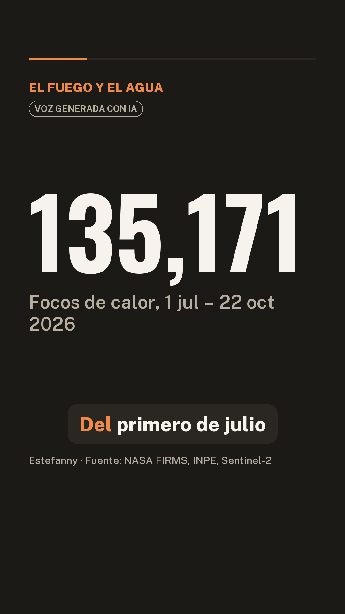

# El fuego y el agua · reel con voz clonada y música generada con código

Ejercicio de la **Sesión 15 · Del texto a tu voz** del curso
[Data-Science-Python](https://github.com/d2cml-ai/Data-Science-Python/tree/main/sessions/15-texto-a-reel).
Un guion revisado a mano sobre los focos de calor de la temporada 2026 en las zonas que le dan agua al Perú
se convierte en un reel vertical de 46 segundos (1080×1920), narrado con mi voz clonada y con música de fondo.



## Resultados

| Archivo | Qué es |
|---|---|
| `salidas/reel.mp4` | Reel con voz clonada y música de fondo (la música baja sola cuando hay voz) |
| `salidas/posts.md` | Textos para publicar en Instagram, X y LinkedIn; cada uno termina con «Voz generada con IA» |
| `salidas/reel.srt` | Subtítulos palabra por palabra, generados con Whisper |
| `salidas/portada.png` | Un cuadro del reel para usar como miniatura |
| `salidas/creditos.txt` | Autora, fuentes de datos, música y aviso de voz con IA |
| `salidas/guion.json` | El guion revisado (7 escenas): frase, cifra y etiqueta |

## Estructura

```
Guión_ejercicio/
├── README.md
├── .gitignore
├── hacer_reels.py       genera el reel
├── reel.py              voz clonada, subtítulos y video (copiado de la sesión 15)
├── musica_tension.py    música de fondo generada con código
├── fuentes/             Oswald y Public Sans (Google Fonts, licencia OFL)
└── salidas/             guion revisado, videos, subtítulos, portada y créditos
```

## Pasos

| Paso | Herramienta | Archivo |
|---|---|---|
| 1. Guion por escenas, revisado contra la fuente | a mano | `salidas/guion.json` |
| 2. Guion → narración con mi voz, con la misma entonación en todas las escenas | Qwen3-TTS 0.6B (Alibaba, Apache 2.0) | `hacer_reels.py`, `reel.py` |
| 3. Narración → subtítulos y control de calidad (WER por escena) | Whisper large-v3-turbo (MIT) | `reel.py` |
| 4. Música que sigue las escenas | NumPy | `musica_tension.py` |
| 5. Video con cifras, subtítulos, voz y música | Pillow + ffmpeg | `hacer_reels.py` |

### La voz: la misma entonación en todas las escenas

En la primera versión, cada escena se narraba por separado con muestreo al azar (temperatura 0.9) y la voz cambiaba
de entonación de una escena a otra. Comparé cuatro opciones en las escenas 1, 4 y 7, midiendo tono, variación del
tono y ritmo de cada escena:

| Opción | Resultado |
|---|---|
| A · Como venía (temperatura 0.9, sin semilla) | Cada corrida sale distinta |
| B · Semilla fija y temperatura 0.6 con mi grabación como muestra | Falló: la escena 7 no terminaba (11 s para 8 palabras) |
| C · Todas las escenas en una sola generación | Escena 1 más lenta y con 15 % de palabras mal entendidas |
| **D · La escena 1 ya generada como muestra para las demás** | **La más pareja: el tono de cada escena queda a 0.5 semitonos de la escena 1** |

`hacer_reels.py` usa la opción D: la escena 1 (`muestra_escena1.wav`, con la entonación que elegí) se usa tal cual y es
la muestra de voz, con su texto exacto, para las escenas 2 a 7, que se generan con semilla fija (1234), temperatura
0.6, `top_k` 20 y un tope de largo por escena. En el reel final, el tono medio de las 7 escenas varía menos de
1 semitono.

### La música

`musica_tension.py` arma la música con código, sin muestras ni derechos de autor, siguiendo los tiempos de cada escena:

- **Inicio (zonas que dan agua):** acorde de re menor, nota grave sostenida y un arroyo suave.
- **Escenas de incendios:** la tensión sube con un latido grave, el crepitar del fuego y un trémolo agudo.
- **Sicuani, el incendio más grande:** un siseo que sube y un golpe grave marcan el clímax, sobre un acorde disonante.
- **Cierre:** fa mayor, la música se calma y vuelve el agua.

La música se mezcla unos 12 dB por debajo de la voz y baja sola cuando hay voz (sidechain de ffmpeg).

## Cómo correrlo

```bash
uv venv .venv
uv pip install --python .venv/Scripts/python qwen-tts faster-whisper pillow imageio-ffmpeg soundfile jiwer num2words pypdf truststore
.venv/Scripts/python hacer_reels.py
```

En Mac o Linux la ruta es `.venv/bin/python`. La primera corrida baja unos 4 GB de modelos; en una laptop con CPU
el proceso completo tarda unos 7 minutos. Para cambiar la autora o la fuente, editen `AUTOR` y `FUENTE` en `hacer_reels.py`.

Notas para Windows:

- `truststore` hace que Python use los certificados de Windows. Hace falta si un antivirus (por ejemplo, Kaspersky)
  revisa las conexiones HTTPS; sin él, la descarga de modelos falla con `CERTIFICATE_VERIFY_FAILED`.
- Si la descarga de Hugging Face falla con `WinError 1314` (enlaces simbólicos), bajen los modelos uno por uno:
  `snapshot_download(repo, max_workers=1)`, o activen el modo de desarrollador de Windows.

## La grabación de voz no está incluida

Por privacidad, **mi grabación de voz no está en este repositorio**, ni la muestra de la escena 1
(`muestra_escena1.wav`), ni ningún audio suelto con mi voz o con la voz clonada (`.gitignore` excluye `mi_voz.m4a`,
`Audio.mp4` y todos los `.wav`, `.m4a`, `.mp3`, `.opus` y `.ogg`).

Para reproducir el proyecto, usen **su propia voz**: graben de 10 a 25 segundos en un cuarto callado (una nota de voz
de WhatsApp sirve) y guárdenla como `mi_voz.m4a` en esta carpeta. Clonen solo su voz o la de alguien que lo autorizó
por escrito. En la primera corrida, `hacer_reels.py` genera la escena 1 con su grabación y la guarda como
`muestra_escena1.wav`; si no les gusta cómo suena, bórrenla y vuelvan a correrlo.

## Créditos

- **Autora:** Estefanny.
- **Datos:** NASA FIRMS, INPE, Sentinel-2.
- **Voz:** generada con IA (Qwen3-TTS) a partir de la voz de la autora. El video lo indica en pantalla.
- **Música:** generada con código (`musica_tension.py`), sin derechos de autor.
- **Código base:** `reel.py` viene de [d2cml-ai/Data-Science-Python](https://github.com/d2cml-ai/Data-Science-Python),
  sesión 15 (MIT License, Copyright (c) 2025 d2cml-ai).
- **Fuentes tipográficas:** Oswald y Public Sans, de Google Fonts (SIL Open Font License).
- **Modelos de IA:** el proyecto usa dos modelos abiertos, que corren en local (CPU):

| Paso | Modelo | Laboratorio · licencia | Archivo |
|---|---|---|---|
| Guion → narración con mi voz clonada | Qwen3-TTS 0.6B (`Qwen/Qwen3-TTS-12Hz-0.6B-Base`) | Alibaba · Apache 2.0 | `hacer_reels.py`, `reel.py` |
| Transcribir la grabación de referencia, subtítulos y control de calidad (WER) | Whisper large-v3-turbo (`mobiuslabsgmbh/faster-whisper-large-v3-turbo`, vía faster-whisper) | OpenAI · MIT | `reel.py` |

  El guion no se generó con ningún modelo dentro de este proyecto: llegó ya revisado a mano (`salidas/guion.json`).
  `reel.py` también trae código para VoxCPM2 (OpenBMB), pero este proyecto no lo usa.
